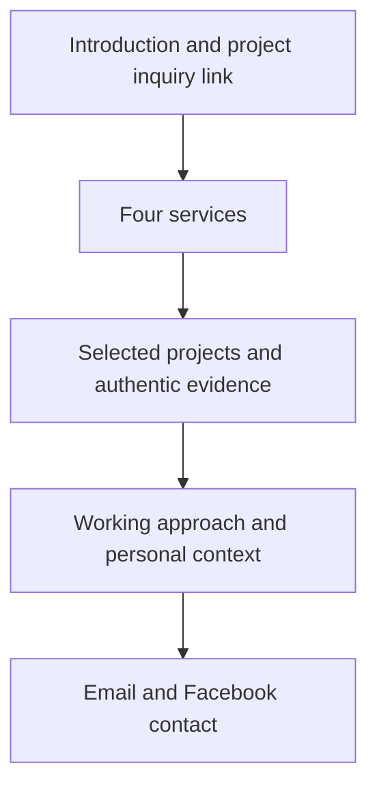
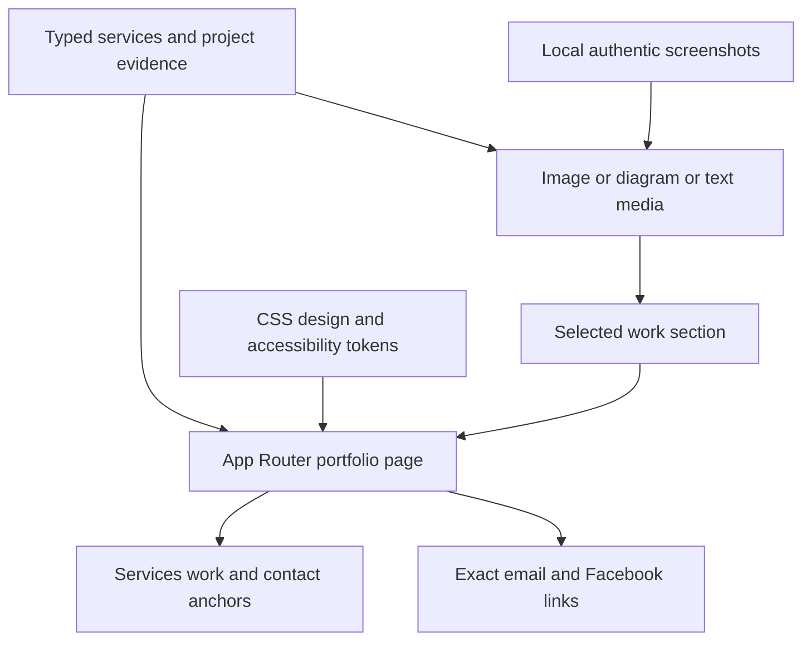

# Client Services Portfolio - Plan

## Goal Capsule

- **Objective:** Potential clients can understand Hans Santos's services, assess real examples of his work, and contact him about a project.
- **Means:** An original, services-first portfolio using Next.js and Tailwind.
- **Product authority:** The Product Contract below records the scope approved by Hans on 2026-10-10. Supporting content evidence is in `docs/portfolio-content.md`; skill applicability is in `docs/ce-workflow.md`.
- **Styling approval:** Hans explicitly selected option 1, Editorial engineering studio, on 2026-10-10. R1 is resolved.
- **Refinement authority (2026-10-11):** Hans approved the existing structure and requested a more interactive, modern presentation inspired by Ben Scott's portfolio. Preserve the editorial palette, truthful evidence, services-first order, and R2–R12. Amplify the visual hierarchy and interactions; this request supersedes the initial quiet-motion limit and composition C as the final layout target. R1 remains resolved.
- **Execution authority:** Hans invoked `lfg` and then approved styling; continue planning, implementation, verification, and PR delivery through that pipeline.
- **Execution profile:** Complete the user-selected visual mockup before production UI, then implement units in dependency order. The Product Contract governs behavior; the Planning Contract governs mechanisms.
- **Stop conditions:** Surface evidence that a required or session-settled decision cannot work. Routine implementation details and unavailable project media use the documented defaults.
- **Tail ownership:** Implementation returns verification evidence to LFG; LFG owns review, shipping, and PR follow-up. Production deployment is outside the scope below.

---

## Product Contract

### Summary

Create a portfolio that introduces Hans's programming and hardware services, supports them with real project evidence, and makes email and Facebook contact easy.
Use the approved services-first structure with an original visual identity informed by the reference portfolio.
The approved visual direction is Editorial engineering studio.

### Problem Frame

Hans feels the current portfolio is too basic to give potential clients confidence in hiring him.
The live site describes projects across web development, firmware, and electronics, but its work section is primarily textual.
The intended audience is prospective clients, rather than recruiters.

### Key Decisions

- **Services first.** Governs R3 and R4. (session-settled: user-directed — chosen over work-first and a single featured build: clients should understand what they can hire Hans for before reviewing proof.)
- **Direct contact.** Governs R9. Email and Facebook replace the proposed inquiry-form option.
- **Real evidence with staged hardware media.** Governs R6–R8. Existing web projects can provide visuals; hardware photos and videos will be supplied later.
- **Explicit styling choice.** Governs R1. The user requested tailored options and a decision before downstream work.
- **Editorial engineering studio.** Governs R1 and R8. (session-settled: user-approved — Hans chose option 1 over dark technical studio, contemporary maker portfolio, and the suggested orange-accent mix.) Warm ivory surfaces, near-black text, cobalt accents, large sans-serif headings, generous spacing, wide authentic screenshots, clearly labeled hardware diagrams, quiet fades and link feedback. Preserve mobile readability, keyboard focus, and reduced-motion behavior. No orange-accent mixture was selected.
- **Fixed stack.** Governs R2. Next.js and Tailwind are explicit user constraints, not a framework comparison to reopen.

### Requirements

**User control and platform**

- R1. Before implementation planning, scaffolding, production code, or final visual assets, the agent must ask Hans how he wants the exact styling to look, present three tailored options with analysis and a recommendation, and wait for his explicit choice or requested mix; silence, the selected wireframe, and invocation of an autonomous skill do not satisfy this gate.
- R2. Build the eventual website with Next.js and Tailwind.

**Client understanding**

- R3. Present web development, app development, electronics engineering, and embedded systems as services clients can hire Hans for.
- R4. Follow the approved sequence: introduction, services, selected projects, working approach, and contact, with concise personal context where it supports trust.
- R5. Explain each service and featured project in client-readable language, using technical details as supporting evidence.

**Evidence and originality**

- R6. Use authentic web project screenshots from the linked repositories or running demos, after verifying what the source actually supports.
- R7. Present embedded projects with factual descriptions and clearly labeled diagrams when real media is absent, allowing Hans to add photos or videos later without redesigning the page.
- R8. Preserve truthful project claims and an original identity: do not copy the reference's assets, copy, or distinctive composition, and do not invent clients, testimonials, results, credentials, or project imagery.

**Contact and navigation**

- R9. Provide clearly labeled email and Facebook contact links using the exact destinations in `docs/portfolio-content.md`.
- R10. Make services, work, and contact easy to reach on desktop and mobile, with keyboard-accessible controls and visible focus states.
- R11. Keep content readable without animation and respect reduced-motion preferences.
- R12. Provide usable alternatives for unavailable project media or demos without displaying broken images or dead primary actions.

### Actors

- A1. A prospective client evaluating whether Hans can build a website, application, electronics project, or embedded system.
- A2. Hans, who chooses the visual direction and supplies updated project evidence.
- A3. The future planning and implementation agent, which must honor the styling gate before advancing.

### Key Flows

- F1. Evaluate and contact. **Covers R3–R6, R9–R10.** A client arrives, understands the offer, identifies a relevant service, inspects related work, and chooses email or Facebook to discuss a project.
- F2. Evaluate a hardware build. **Covers R5, R7–R8.** A client reads the smart drawer's purpose and connected components, sees an explicitly illustrative diagram, and can inspect available source evidence without being led to believe a real photograph exists.
- F3. Choose the visual identity. **Covers R1, R8.** The agent reviews the brief and reference, presents tailored styling choices, receives Hans's choice or correction, and records the accepted direction before planning implementation.
- F4. Maintain project evidence. **Covers R7, R12.** Hans adds real hardware media later; the project presentation accommodates it while retaining its description and contact path.

The following is the approved content order, not a final layout or visual design:

### Acceptance Examples

- AE1. **Covers R1.** Given a future `lfg` request with no recorded styling approval, the agent first presents styling options and waits; it does not infer approval or scaffold an app.
- AE2. **Covers R1, R8.** Given Hans chooses a mix, the agent records the combined palette, typography, composition, imagery, and motion intent accurately before advancing; no rejected option remains a competing authority.
- AE3. **Covers R3–R5.** Given a client needs an application, the services section clearly offers app development without requiring the client to decode a technology list or infer it from a firmware project.
- AE4. **Covers R6, R8, R12.** Given a repository has no usable screenshot, the builder can capture its working demo; if neither source provides usable media, the project uses an honest text treatment rather than an invented screen or broken image.
- AE5. **Covers R7–R8.** Given no hardware photo exists, the smart drawer presentation identifies its diagram as illustrative and makes no claim about customers, measured performance, or commercial deployment without evidence.
- AE6. **Covers R9.** Given a visitor activates Email, the link targets `mailto:hansprielasantos02@gmail.com`; Facebook targets `https://www.facebook.com/profile.php?id=61576625156355` with no embedded messaging form.
- AE7. **Covers R10–R11.** Given a narrow screen, keyboard navigation, or reduced motion, services, project evidence, and both contact routes remain readable and operable.
- AE8. **Covers R12.** Given a project demo is unavailable during verification, its primary action is removed or replaced by a verified source link, and its description does not imply a working live demo.

### Success Criteria

Clients can answer what Hans offers, see a relevant example, and find a contact route without interpreting internal implementation jargon.
Visual quality is judged against the direction Hans approves under R1, not against the disposable grayscale sketches.
Every published claim and project image has a traceable source; interest or inquiry growth is a business objective, not a promised or measured result.

### Scope Boundaries

The first release is the public services portfolio and its project evidence, not a client portal, CMS, booking system, payment flow, or inquiry backend.
Real hardware photos and videos are deferred until Hans supplies them.
Project case-study routing and the number of featured projects may be determined during planning from available evidence, without adding new product capabilities.
A short working-approach section may describe discussing scope, building, and reviewing, but must not promise turnaround times, revisions, support packages, or commercial terms Hans has not supplied.
The user-invoked LFG run authorizes source commits, push, and PR delivery. Production deployment is not part of this release workflow.

### Dependencies and Assumptions

The current checkout contained only `README.md` before these planning documents, as independently verified on 2026-10-10.
There is no established application architecture or test command to preserve in this checkout.
The live portfolio is a content source, not proof that every project claim or linked demo is current.
Repository assets, demo availability, ownership, and screenshot suitability still need source-level inspection.
Dedicated app-development evidence has not yet been identified; the service can be offered without inventing a mobile application project.
The working assumption is an English-language public site; no localization requirement was requested.

### Outstanding Questions

**Resolve Before Planning**

- None. Hans explicitly approved option 1 under R1 on 2026-10-10: warm ivory, near-black text, cobalt accents, large sans-serif headings, generous spacing, wide authentic project screenshots, labeled hardware diagrams, and restrained motion.

**Resolved During Planning**

- Project selection, evidence acquisition, content maintenance, routing, dependencies, and working-approach copy are addressed in the Planning Contract.

**Deferred to Implementation; Non-Blocking**

- Inspect the actual web demos before capture. If capture or demo availability fails, apply R6 and R12 with the evidence treatment in KTD3.
- Resolve final typography metrics, section geometry, and screenshot crops against the user-selected visual mockup while preserving R1's approved direction.

### Sources and Supporting Documents

- [Current portfolio](https://hanssantos-portfolio.vercel.app/): browser-inspected on 2026-10-10 for services, projects, and contact content.
- [Reference portfolio](https://benscott.dev/#about): browser-inspected on 2026-10-10 for hierarchy and visual project emphasis; inspiration only.
- `docs/portfolio-content.md`: exact destinations, project inventory, evidence limitations, and research leads.
- `docs/ce-workflow.md`: styling discussion prompts, downstream handoff, and all 35 available CE skill roles.

---

## Planning Contract

**Product Contract preservation:** Product Contract unchanged. Existing R1–R12, A1–A3, F1–F4, and AE1–AE8 retain their meaning and IDs; deferred planning questions now point to their technical resolutions.

### Key Technical Decisions

- KTD1. **One App Router page with static content.** Use TypeScript and the Next.js App Router at `/`, with semantic server-rendered sections and ordinary hash links for Services, Work, and Contact. This instantiates R3–R4 without introducing case-study routing or a content backend. (session-settled: user-directed — services first was chosen over work-first and a single featured build: clients should understand the offer before reviewing proof.) The fixed stack in R2 is workable for this content-only release; its runtime and dependency cost is larger than a plain static page, but no incompatibility warrants changing it. Follow [Next.js installation guidance](https://nextjs.org/docs/app/getting-started/installation).
- KTD2. **Central CSS tokens and restrained components.** Define palette, type scale, spacing, focus, and motion tokens in `src/app/globals.css`, using Tailwind v4 for layout. This implements the approved direction under R1 and R8. (session-settled: user-approved — editorial engineering studio was chosen over dark technical studio, contemporary maker portfolio, and an orange-accent mix: clear hierarchy supports all four services.) Use typography and section rhythm to establish hierarchy, with service rows and substantial project previews rather than a uniform grid of interchangeable cards. Responsive geometry is fluid, with a single column on narrow screens. CSS motion is optional decoration and cannot control whether content is visible.
- KTD3. **Typed local content with independent media and link availability.** Keep services, project facts, source provenance, exact contacts, optional demo status, and media variants in `src/content/portfolio.ts`. A project can use an authentic local screenshot, a labeled illustrative diagram, or a text presentation under R6–R8 and R12. Record source URL and verification date separately from visitor copy. Demo availability does not follow from screenshot availability. A minimal client media boundary handles image loading failure while retaining the surrounding description and source link; substantive text and links stay server-rendered. Hardware media replacement changes data and assets under F4, not the page structure.
- KTD4. **Local images and an original source-based hardware diagram.** Store captured screenshots under `public/projects/`, with explicit dimensions, alt text, and factual captions. Use Next.js Image for responsive sizing and avoid hotlinked evidence that could disappear or leak visitor requests to project hosts. Draw the smart drawer component relationship directly in SVG/HTML from verified source evidence, and label that media “Illustrative diagram.” A diagram communicates connections and purpose, not a physical wiring guide or proof of a photographed prototype. Follow [Next.js Image guidance](https://nextjs.org/docs/app/api-reference/components/image).
- KTD5. **Direct accessible navigation and contact.** Use an always-visible compact navigation that wraps on mobile, a skip link, semantic headings, and anchored section IDs. If the header is sticky, reserve scroll space for target headings. Contact uses R9's exact destinations and displays the email address for copying. Facebook can require login, and email hands off to the visitor's mail application; no in-site message-sent state exists. Follow WCAG 2.2's [contrast](https://www.w3.org/WAI/WCAG22/Understanding/contrast-minimum.html), [unobscured focus](https://www.w3.org/WAI/WCAG22/Understanding/focus-not-obscured-minimum.html), and [target size](https://www.w3.org/WAI/WCAG22/Understanding/target-size-minimum.html) guidance under R10–R11. Use at least 4.5:1 normal-text contrast, 3:1 large-text contrast, and 24px target size or qualifying spacing; larger contact targets are preferred.
- KTD6. **Runtime smoke checks plus focused browser regression coverage.** Use npm with a committed lockfile and scripts for lint, typecheck, production build, start, and Playwright browser tests. Test observable page, contact, navigation, and media behaviors rather than snapshotting typography or duplicating content in unit assertions. Next.js 16 no longer runs lint through its build, so lint is an explicit separate gate. No skill evaluation, native iOS tests, or `release:validate` command applies to this website.

### Dependency Baseline

Research on 2026-10-10 found [Next.js 16.4.0](https://registry.npmjs.org/next/latest), [React 19.3.0](https://registry.npmjs.org/react/latest), [Tailwind CSS 4.3.3](https://registry.npmjs.org/tailwindcss/latest), and [Playwright 1.64.0](https://registry.npmjs.org/@playwright%2ftest/latest) in the official package registry.
The available Node.js 24.18.1 satisfies Next.js's Node >=20.9 and Playwright's Node >=20 requirements.
Use mutually compatible stable package versions from that baseline, pin the installed resolution in `package-lock.json`, and include TypeScript >=5.1, ESLint with `eslint-config-next` matching Next, and `@tailwindcss/postcss`.
Follow [Tailwind's Next.js integration](https://tailwindcss.com/docs/installation/framework-guides/nextjs), including the v4 PostCSS setup rather than a v3 configuration copied from memory.
Default to the ordinary Next.js build/start model, compatible with a future Vercel deployment, without configuring or triggering production hosting.

### Evidence and Copy Decisions

Feature Ledger, Library, and Smart Fingerprint Unlock Drawer as the initial evidence candidates.
These span useful browser applications and embedded/electronics work while keeping the offer readable.
Source inspection found no existing screenshot or hardware photo assets in these repositories, so web evidence requires real demo capture during implementation.
If either browser candidate cannot supply usable evidence, Calculator is a smaller source-backed substitute; R6 and R12 govern any unavailable-media outcome.
Weather App is excluded from featured evidence because its visitor-held API key complicates a reliable public demo.
Dedicated native app evidence remains unidentified, and R3's app-development offer does not imply a fabricated app case study.

Project copy describes purpose, Hans's contribution as supported by his repository, and observable behavior.
Treat the web examples as personal projects, not customer commissions.
The smart drawer description may name only the component and behavior claims confirmed by its README and firmware; omit unsupported performance, security, customer, or deployment claims under R8.
Its [README](https://github.com/hanssantos02/Smart-Fingerprint-Unlock-Drawer/blob/ba11f70731c79f7df36f25c81aa1ebf8a78c6129/README.md) and [firmware](https://github.com/hanssantos02/Smart-Fingerprint-Unlock-Drawer/blob/ba11f70731c79f7df36f25c81aa1ebf8a78c6129/SmartDrawer.ino) support fingerprint authentication, local enrollment, lock control, and a browser dashboard for user management and recent activity.
The dashboard has no login/authentication, so “secure” and “production-ready” would be unsupported claims.
Ledger's [source](https://github.com/hanssantos02/todo-list/blob/d393d24522104fb785cb4e438001766049c45da9/src/index.js) and [storage module](https://github.com/hanssantos02/todo-list/blob/d393d24522104fb785cb4e438001766049c45da9/src/storage.js) support project organization, priorities, dates, completion, and local storage.
Library's [current source](https://github.com/hanssantos02/Library/blob/b922d10ffeda259151cb2b0717433a0be803edb2/javascript.js) supports validated book entry, read status, search, and filtering but not persistence across refresh; its README's future-work list is stale.
Working-approach copy can describe discussing the need, shaping a practical scope, building, and reviewing the result, using the boundary already stated in the Product Contract.
Concise location and personal context from `docs/portfolio-content.md` support trust; current employment availability, skill proficiency ratings, résumé freshness, and ongoing ML work are excluded until confirmed.

### High-Level Technical Design

The only client behavior needed for the content flow is image failure handling.
No API, database, browser storage, authentication, or third-party runtime data source is required.
Metadata in `src/app/layout.tsx` identifies Hans and his services; optional social previews cannot contain invented project evidence.

### Assumptions

These are unvalidated implementation defaults, not additional product requirements:

- Three selected projects provide enough evidence for the initial page; the chosen candidates may change only when source or demo verification makes a candidate unsuitable.
- English remains the publication language, as carried from the Product Contract.
- A system or locally bundled sans-serif font can deliver the approved type character without a runtime remote-font dependency. Final choice follows the visual mockup.
- Content updates happen through source edits and builds. A CMS is unnecessary for the stated maintenance flow.

### Sequencing and Risks

Complete the visual mockup in the approved style before U3's production UI work.
U1 establishes the runtime; U2 establishes factual content and assets; U3 assembles the page; U4 makes its media and responsive behavior robust; U5 verifies the built site and documents maintenance.

Live demos can change or fail after capture. Keep verification dates and provenance in `docs/project-evidence.md`, apply R12 at release verification, and retain repository links independently of demos.
The smart drawer source demonstrates firmware intent, not hardware test results. Captions and copy under R8 must preserve that distinction.
Local screenshots can create a large page payload. Size them for their displayed dimensions, reserve aspect ratios, and defer below-fold image loading without delaying text.
The original checkout's documentation-only status text may be stale after the approved LFG invocation; update supporting status language to match the canonical plan without changing its product scope.

---

## Implementation Units

### U1. Establish the Next.js and Tailwind runtime

- **Goal:** Provide a reproducible TypeScript application that builds and serves the portfolio.
- **Requirements:** R2; KTD1, KTD2, KTD6.
- **Dependencies:** None.
- **Files:** `package.json`, `package-lock.json`, `tsconfig.json`, `next-env.d.ts`, `next.config.ts`, `postcss.config.mjs`, `eslint.config.mjs`, `.gitignore`, `src/app/layout.tsx`, `src/app/globals.css`.
- **Approach:** Use the supported dependency baseline and App Router conventions. Preserve user-owned planning documents while scaffolding. Define npm scripts named `dev`, `build`, `start`, `lint`, `typecheck`, and `test:browser` for the Verification Contract.
- **Patterns to follow:** KTD1–KTD2 and official Next.js/Tailwind installation guides; the checkout has no application pattern to preserve.
- **Execution note:** Establish install, typecheck, and runtime smoke proof before feature work; this unit is configuration rather than business behavior.
- **Test expectation:** None — runtime and build gates verify scaffolding without mirroring config in tests.
- **Verification:** Locked dependencies install reproducibly, the root route can serve, and lint/typecheck/build pass without unrelated generated content.

### U2. Establish source-backed content and authentic project media

- **Goal:** Provide truthful services, selected work, and editable evidence for the page.
- **Requirements:** R3, R5–R9, R12; A2, F2, F4; AE4–AE6, AE8; KTD3–KTD4.
- **Dependencies:** U1.
- **Files:** `src/content/portfolio.ts`, `public/projects/ledger.webp`, `public/projects/library.webp`, `docs/project-evidence.md`, `tests/portfolio.spec.ts`, `tests/media.spec.ts`.
- **Approach:** Verify candidate repositories and real demos, then capture representative screens without altering what their actual interfaces show. Record concrete source paths and capture provenance in the evidence document. Populate the media/link variants from KTD3 and exact contact destinations from R9. Keep hardware relationships tied to source-confirmed behavior.
- **Patterns to follow:** `docs/portfolio-content.md` as factual leads, source READMEs and owning code as evidence, KTD3 for content boundaries.
- **Test scenarios:**
  1. Covers AE6. Render both contact routes and confirm the exact email and Facebook destinations.
  2. Covers AE4 / AE8. Supply a project with no media and an unavailable demo; its purpose and verified source link remain, with no broken image or demo primary action.
  3. Covers F4. Replace diagram media with an authentic image entry; the same project layout can show it with the updated caption and no illustrative label.
- **Verification:** Every published claim and capture has a source recorded; media files exist with correct dimensions; each selected project has an honest evidence treatment.

### U3. Build the editorial services-first page

- **Goal:** Clients can understand the offer, inspect work, and reach contact in the approved sequence.
- **Requirements:** R1, R3–R5, R8–R11; F1, F3; AE1–AE3, AE6–AE7; KTD1–KTD2, KTD5.
- **Dependencies:** U1, U2, and the user-selected visual mockup.
- **Files:** `src/app/page.tsx`, `src/app/layout.tsx`, `src/app/globals.css`, `src/components/site-header.tsx`, `src/components/services.tsx`, `src/components/selected-work.tsx`, `src/components/project-media.tsx`, `tests/portfolio.spec.ts`.
- **Approach:** Translate the mockup into semantic sections in R4's order, populated from U2. Keep personal context and working approach concise. Use KTD2's tokens and composition hierarchy; show app development clearly even without an app case study. Integrate KTD5's header, skip link, and direct contact.
- **Patterns to follow:** Canonical Product Contract and visual mockup as the design target, KTD1 for server content, KTD5 for navigation.
- **Test scenarios:**
  1. Covers F1 / AE3. A visitor arriving at `/` sees all four service offers, then selected work, approach, and contact in document order.
  2. Covers AE6. Activating visible contact links exposes exact destinations without submitting messages.
  3. Covers AE7. Keyboard traversal reaches the skip link, services/work/contact navigation, project source links, and both contacts with visible focus.
  4. Direct navigation to `/#services`, `/#work`, or `/#contact` exposes the intended section heading without a sticky-header obstruction.
  5. With JavaScript disabled, substantive page content and navigation/contact links remain readable and operable.
- **Verification:** Desktop and narrow mobile screenshots match the approved editorial direction; section ordering, headings, service clarity, and contact flow satisfy the traced examples.

### U4. Complete evidence fallbacks and responsive accessibility

- **Goal:** Project proof and contact remain usable when media fails or the visitor needs narrow layouts or reduced motion.
- **Requirements:** R6–R8, R10–R12; F2, F4; AE4–AE5, AE7–AE8; KTD3–KTD5.
- **Dependencies:** U2, U3.
- **Files:** `src/components/project-media.tsx`, `src/components/smart-drawer-diagram.tsx`, `src/app/globals.css`, `tests/media.spec.ts`, `tests/portfolio.spec.ts`.
- **Approach:** Implement the labeled diagram with text alternatives, image-failure boundary, and reserved media geometry under KTD3–KTD4. Verify wrapping navigation, enlarged text, touch targets, contrast, and reduced motion under KTD5. Keep project purpose and links outside fragile image rendering.
- **Patterns to follow:** R7's later-media maintenance flow and KTD3's media variants; use native elements before custom interaction state.
- **Test scenarios:**
  1. Covers AE5. Drawer media is visibly identified as illustrative and has readable component context without a claim of a real photograph.
  2. Covers AE4. Force an image request to fail; the broken image disappears while project title, purpose, caption context, and source action remain usable.
  3. Covers AE7. At 360px and enlarged text, no page-level horizontal scroll appears and navigation/contact remain reachable.
  4. Covers AE7. With reduced motion, content remains visible and decoration does not animate or smooth-scroll against that preference.
  5. Covers F4. Exercise image, diagram, and text variants in the same media component without changing the surrounding project flow.
- **Verification:** Real failure interception and viewport checks pass; browser inspection confirms readable fallback treatment and media aspect ratios without disruptive layout shifts.

### U5. Verify the production site and document maintenance

- **Goal:** The release has reproducible proof and Hans can update its evidence safely.
- **Requirements:** R2–R12; F1–F2, F4; AE3–AE8; KTD6.
- **Dependencies:** U1–U4.
- **Files:** `playwright.config.ts`, `tests/portfolio.spec.ts`, `tests/media.spec.ts`, `README.md`, `docs/project-evidence.md`, `docs/ce-workflow.md`.
- **Approach:** Run focused tests against the production build, complete desktop/mobile browser inspection, and record source/demo checks and captures. Document local commands, content/asset update locations, and F4's media replacement flow. Reconcile stale workflow status while preserving the canonical contract. Do not introduce CI or hosting integration solely for this unit.
- **Patterns to follow:** Verification Contract below, source provenance in U2, exact acceptance examples rather than tests that mirror markup.
- **Test scenarios:** Existing U2–U4 scenarios are run together against the built page; do not duplicate them in a second suite.
- **Verification:** All applicable gates pass with the final source state; selected demo/source checks are recorded; README explains how to run the app and replace project media.

---

## Verification Contract

These are the intended repository scripts established in U1, not commands claimed to exist in the initial checkout.

| Gate | Command or inspection | Units | Passing signal |
|---|---|---|---|
| Reproducible dependencies | `npm ci` | U1 | Lockfile installs the chosen compatible packages |
| Lint | `npm run lint` | U1–U5 | ESLint reports no errors |
| Type safety | `npm run typecheck` | U1–U5 | TypeScript reports no errors |
| Production compilation | `npm run build` | U1–U5 | Next.js builds the root route successfully |
| Browser regression | `npm run test:browser` | U2–U5 | Production-page navigation, contacts, viewport, reduced motion, no-JS, and media failure scenarios pass |
| Visual and accessibility inspection | Desktop and 360px mobile browser review | U3–U5 | Approved style, readable hierarchy, keyboard focus, touch targets, contrast, and honest media labels verified |
| External evidence | Source/demo review recorded in `docs/project-evidence.md` | U2, U5 | Published claims/captures trace to actual sources and unavailable demo actions obey R12 |

Playwright can start the production server through its configuration after the build gate.
Follow [Next.js's Playwright production-testing guidance](https://nextjs.org/docs/app/guides/testing/playwright).
Use browser screenshots as review evidence without brittle pixel-diff assertions for this first design.
Verify contact destinations without sending email or Facebook messages.
No `release:validate` script exists or is required, and no native platform or skill behavior evaluation applies.

---

## Definition of Done

- U1 delivers a reproducible runtime and passing lint/typecheck/build gates.
- U2 delivers source-backed content, actual screenshots or honest alternatives, and recorded provenance.
- U3 delivers the approved services-first page and direct contact flow.
- U4 delivers usable responsive, reduced-motion, and media-failure behavior.
- U5 delivers final verification evidence and maintenance instructions.
- All Product Contract acceptance examples that affect the website are covered by implementation evidence; R1's styling approval remains recorded rather than reopened.
- The final diff contains no abandoned scaffold examples, dead-end comps in production assets, unused dependencies, fabricated claims, secrets, or experimental code.
- The website is reviewable from its production build, with shipping handled by the authorized pipeline and no production deployment performed as part of this plan.
